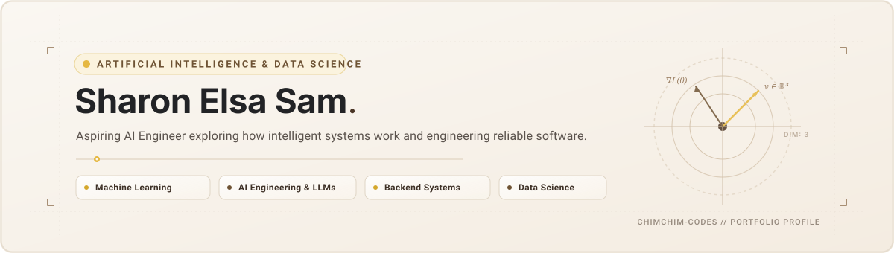

<<<<<<< HEAD

<!-- Minimal Editorial Banner -->

  

<!-- Social / Identity Badges -->

&nbsp;

&nbsp;

  

# Sharon Elsa Sam

**Artificial Intelligence & Data Science Student · Aspiring AI Engineer**  
*Exploring how intelligent systems work and engineering reliable, human-centered software.*

---

### 📖 About Me

I am an undergraduate student in **Artificial Intelligence and Data Science** focused on bridging mathematical models and production-ready software. Rather than treating artificial intelligence as a collection of black-box libraries, I am driven to understand the algorithmic foundations underneath—from linear algebra and optimization to how real-world backend services process and serve predictions.

My goal is to grow into an **AI Engineer** who can build, deploy, and maintain dependable applications that solve genuine problems.

#### 💡 What I'm Curious About

- **Machine Learning & Deep Learning** — Studying loss surfaces, gradient mechanics, representation learning, and evaluation metrics that reflect real-world performance.
- **AI Engineering & LLM Applications** — Investigating how large language models interact with structured data, external tooling, APIs, and retrieval pipelines.
- **Backend Systems & APIs** — Designing clean application programming interfaces, predictable data schemas, and resilient service architectures.
- **Data Science & Forensics** — Finding authentic signal within noisy data, timeline puzzles, and structured records.
- **Intelligent Applications & Practical Problem-Solving** — Translating theoretical concepts into accessible, functional software that people can rely on.

---

### 🛠️ Tech Stack & Tooling

Technologies are categorized by domain. To provide an honest representation of my technical journey, tools I actively use in code are separated from concepts I am actively learning.

#### 💻 Programming Languages
| Category | Technologies |
| :--- | :--- |
| **Actively Using** |   |
| **Currently Learning** |   |

#### 🧠 AI, Machine Learning & Data Science
| Category | Technologies |
| :--- | :--- |
| **Actively Using** |    |
| **Currently Learning** |    |

#### ⚙️ Backend, Desktop & Data Management
| Category | Technologies |
| :--- | :--- |
| **Actively Using** |    |
| **Currently Learning** |    |

#### 🔧 Tools & Development Workflow
| Category | Technologies |
| :--- | :--- |
| **Actively Using** |     |
| **Currently Learning** |    |

---

### 🎯 Currently Learning

These are my active growth goals. They represent areas where I am writing code, reading documentation, and building small iterations:

- [ ] **Python & Engineering Fundamentals** — Exploring idiomatic patterns, object-oriented encapsulation, error handling, and clean code principles.
- [ ] **Mathematical Machine Learning** — Working through vector spaces, matrix transformations, loss functions, and optimization mathematics from first principles.
- [ ] **AI Engineering & LLM Workflows** — Studying retrieval-augmented generation (RAG), prompt architecture, structured JSON outputs, and embedding spaces.
- [ ] **Backend Service Development** — Understanding HTTP methods, request validation, state management, and building clean RESTful interfaces.
- [ ] **Collaborative Git & GitHub** — Moving beyond simple push/pull to feature branches, descriptive commit histories, pull requests, and merge strategies.
- [ ] **Code Maintainability & Testing** — Adopting type hinting, descriptive docstrings, and basic unit testing for predictable software behavior.

---

### 📂 Featured Projects

Each project listed below reflects real, verified code built during my learning journey. Mini-exercises and full applications are distinguished honestly.

#### 🔍 1. Detective Mystery & Digital Forensics: Ramji Rao Speaking
> **A digital forensics case study and desktop investigation game.**

- **Repository**: [chimchim-codes/RamjiRao-Speaking](https://github.com/chimchim-codes/RamjiRao-Speaking)  
  *(Configured local repository: `RamjiRao` — see note below if repository is currently in staging/private mode)*
- **Core Technologies**: `Python 3` · `CustomTkinter` · `Pillow (PIL)` · `JSON Manifest Engine` · `Dynamic File Recovery`
- **What It Solves**: Built around an investigation scenario (*Nisha's Villa*), this application tests analytical and deductive reasoning. Instead of an automated solver, it puts players in the detective's chair—requiring them to inspect crime scenes on an interactive map, decrypt secured records, examine timeline discrepancies, and assemble evidence on a theory board before accusing a suspect.
- **Implemented Technical Features**:
  - **Dynamic Case Pack Discovery**: Reads locations, map markers, and evidence hierarchy dynamically from `case_manifest.json` without hardcoding content into UI views.
  - **Forensic Recovery Engine**: Detects corrupted/tampered evidence files and guides the user through digital forensic restoration routines.
  - **In-Memory Hint Decryption**: Protects clues using encrypted payloads (`hints.dat`), decrypting hints into memory only when requested.
  - **Case Save System**: Serializes investigator notebook entries, unlocked evidence sets, and theory boards into structured JSON save files (`savegames/`).
- **What I Learned**: Modular state separation (`save_manager.py`, `hint_manager.py`, `models.py`), desktop UI architecture with CustomTkinter, and handling complex event-driven game states.

---

#### 🐍 2. Python Mini Projects: Logic & Fundamentals
> **Small, focused applications exploring core Python concepts and GUI programming.**

- **Repository**: [chimchim-codes/Basic-Python-Projects](https://github.com/chimchim-codes/Basic-Python-Projects)

Rather than maintaining separate repositories for introductory exercises, these programs are organized together within a single repository to track progressive learning:

##### 🕹️ A. Rock, Paper, Scissors
- **Source File**: [`RockPaperScissors.py`](https://github.com/chimchim-codes/Basic-Python-Projects/blob/main/RockPaperScissors.py)
- **Key Concepts Practiced**: User input validation, `random.choice()` selection, conditional logic branching (`if` / `elif` / `else`), round-based iteration loops, and persistent session score tracking.
- **Next Improvement**: Add case-insensitive input parsing (`.upper()`), defensive error handling for non-numeric round counts, and an optional probability-based computer opponent.

##### 🔐 B. Password Generator
- **Source File**: [`passwrd_gen.py`](https://github.com/chimchim-codes/Basic-Python-Projects/blob/main/passwrd_gen.py)
- **How It Works**: Accepts user-defined character lengths and samples characters uniformly from alphanumeric strings and punctuation sets via `random.sample()`.
- **Security Context**: *Transparent note* — Uses Python's standard `random` pseudo-random generator (Mersenne Twister), which is appropriate for basic applications but not cryptographically secure.
- **Next Improvement**: Refactor to Python’s built-in `secrets` module (`secrets.choice`) for cryptographically secure entropy, and add configuration flags allowing users to choose character types (uppercase, lowercase, symbols, digits).

##### 📝 C. Desktop To-Do List
- **Source File**: [`to_dolist.py`](https://github.com/chimchim-codes/Basic-Python-Projects/blob/main/to_dolist.py)
- **Implemented Features**: Desktop interface built with `customtkinter` and `tkinter.Listbox`. Supports text entry insertion, dynamic list updating, and deletion of selected task items.
- **What I Learned**: GUI component layout (`.grid()`), event handler callbacks (`add_item`, `delete_item`), and cross-library widget coordination.
- **Next Improvement**: Add local data persistence (saving tasks to a local JSON file or SQLite database so tasks persist after closing) and implement a status toggle for marking tasks completed.

---

#### 🌐 3. Interactive Web Portfolio *(Additional Verified Project)*
> **A scrapbook-inspired personal portfolio exploring motion and responsive web design.**

- **Repository**: [chimchim-codes/Portfolio](https://github.com/chimchim-codes/Portfolio) · **Live Site**: [portfolio-chimchim-codes.vercel.app](https://portfolio-chimchim-codes.vercel.app)
- **Technologies**: `Next.js` · `TypeScript` · `Tailwind CSS` · `Framer Motion`
- **Description**: Designed with tactile, scrapbook-inspired visuals to explore modern frontend patterns, component lifecycle, and web animation physics.

---

### 📊 GitHub Activity & Overview

&nbsp;

 

*Note: GitHub statistics reflect public contributions and repository languages. They represent a visual log of active coding iterations rather than an absolute measure of software engineering depth.*

---

### ⚡ This Week's Focus

- [x] Designing a minimal, editorial GitHub profile README with custom banner assets.
- [ ] Refactoring `Basic-Python-Projects` with input validation, docstrings, and `secrets` module integration.
- [ ] Practicing feature branches, pull requests, and semantic commit conventions on GitHub.
- [ ] Studying mathematical vectors and matrices to prepare for machine learning model development.
- [ ] Maintaining a consistent, meaningful seven-day contribution streak on GitHub.

---

### 📬 Connect With Me

&nbsp;&nbsp;&nbsp;&nbsp;

 

*Open to conversations on AI engineering, machine learning foundations, open-source projects, and collaborative learning.*

=======
## Hi there 👋

<!--
**chimchim-codes/chimchim-codes** is a ✨ _special_ ✨ repository because its `README.md` (this file) appears on your GitHub profile.

Here are some ideas to get you started:

- 🔭 I’m currently working on ...
- 🌱 I’m currently learning ...
- 👯 I’m looking to collaborate on ...
- 🤔 I’m looking for help with ...
- 💬 Ask me about ...
- 📫 How to reach me: ...
- 😄 Pronouns: ...
- ⚡ Fun fact: ...
-->
>>>>>>> 82fafd8e532779d65fa34811817477163c10f62c
